# MLRIT HYDERABAD — HIGH-FIDELITY COLLEGE DIGITAL TWIN & CAMPUS INTELLIGENCE PLATFORM

An enterprise-grade smart campus command center and interactive 3D digital twin of **Marri Laxman Reddy Institute of Technology (MLRIT)**, Dundigal, Hyderabad, Telangana.

  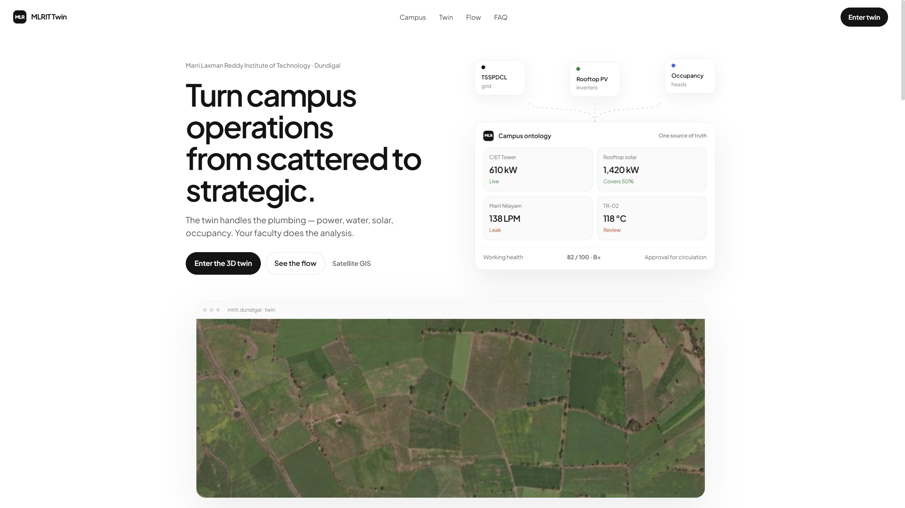

---

## Screenshots

### Landing
| Hero | Workflows |
|:----:|:---------:|
|  | 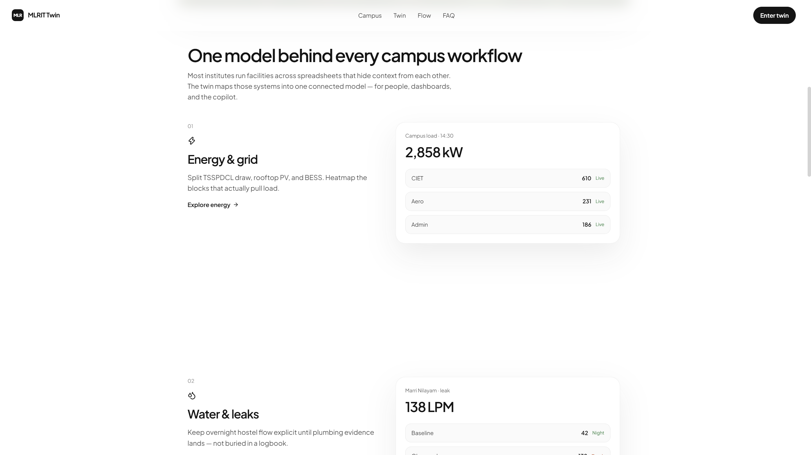 |
| 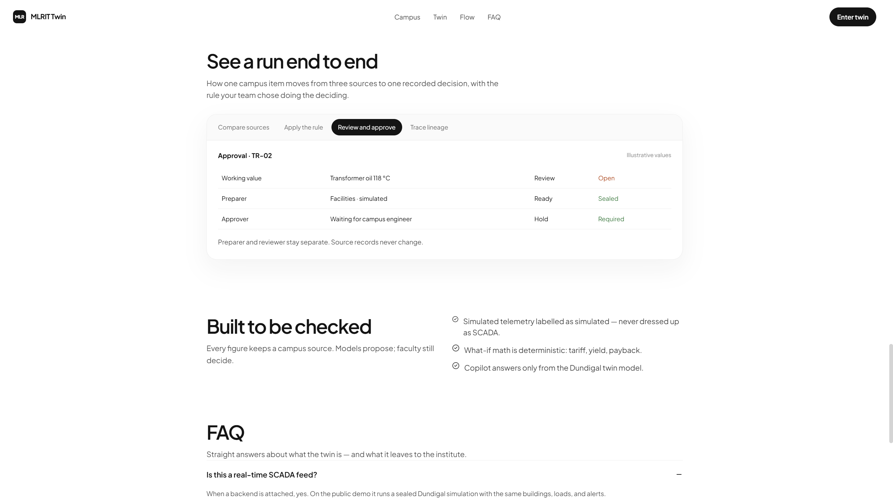 | 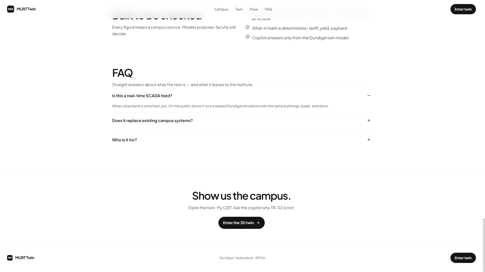 |

### 3D campus twin
| Overview | CIET fly-to |
|:--------:|:-----------:|
| 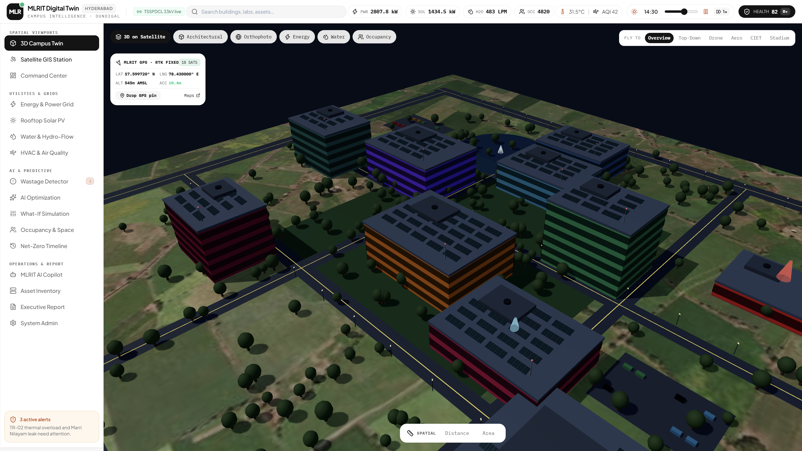 | 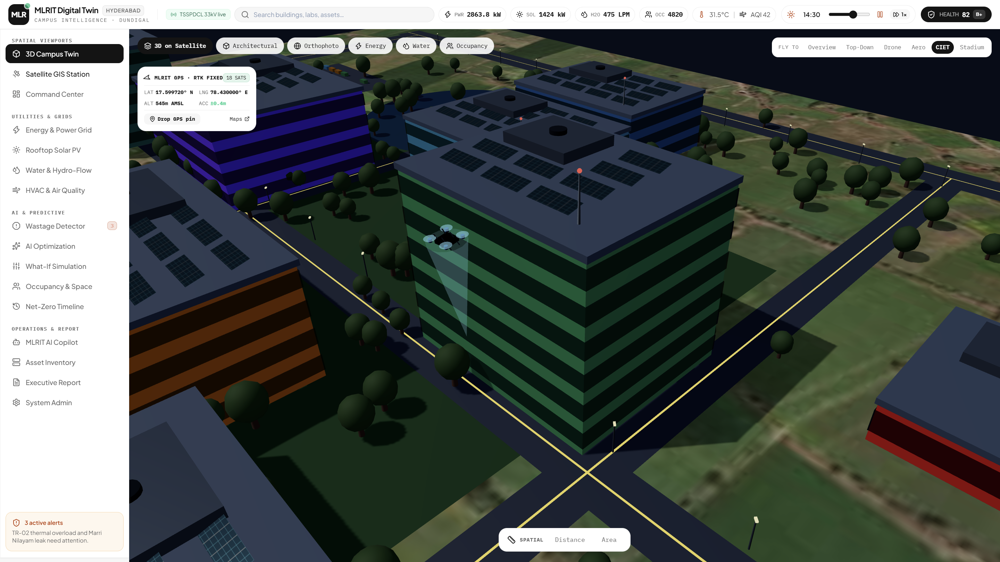 |

  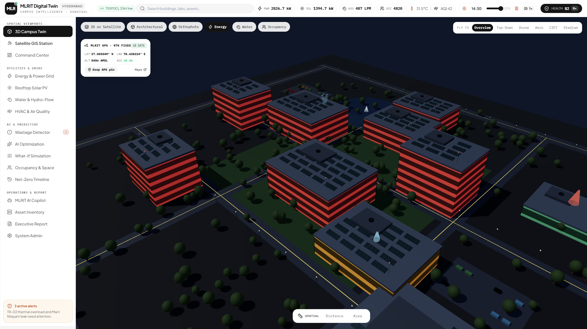

### Command center, GIS, and utilities
| Command Center | Satellite GIS |
|:--------------:|:-------------:|
| 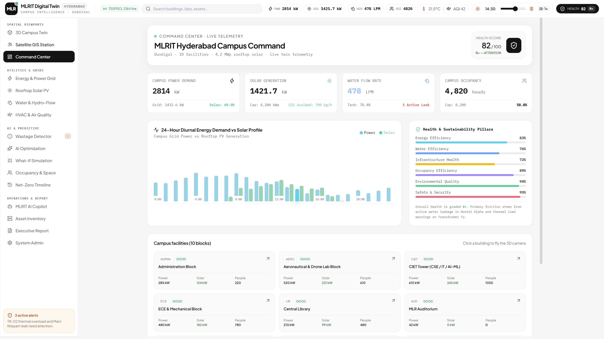 | 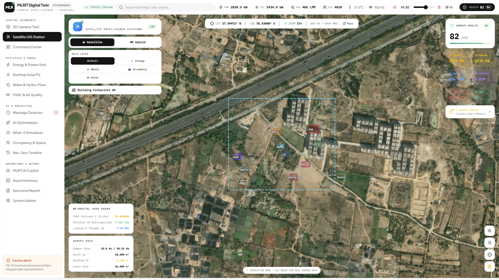 |
| 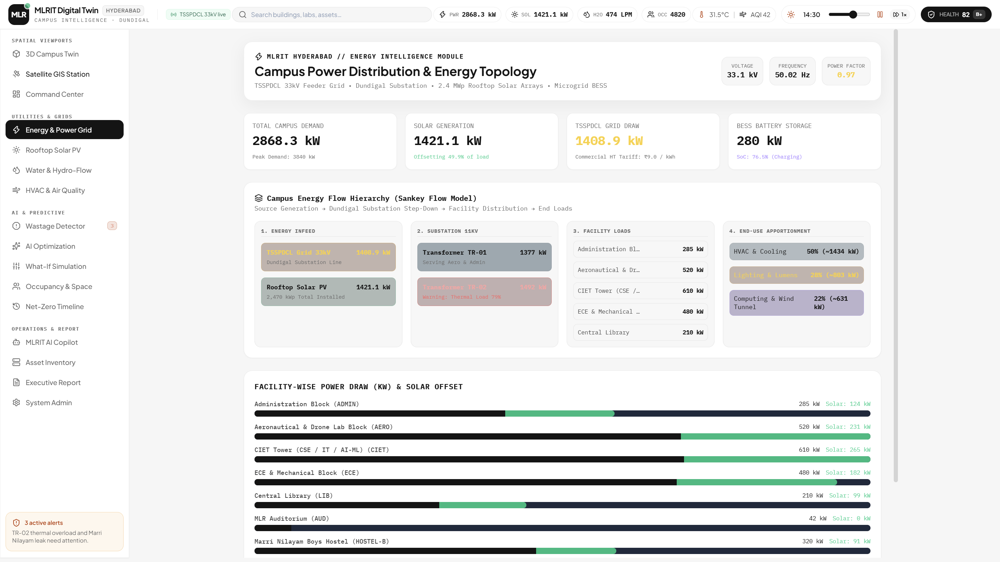 | 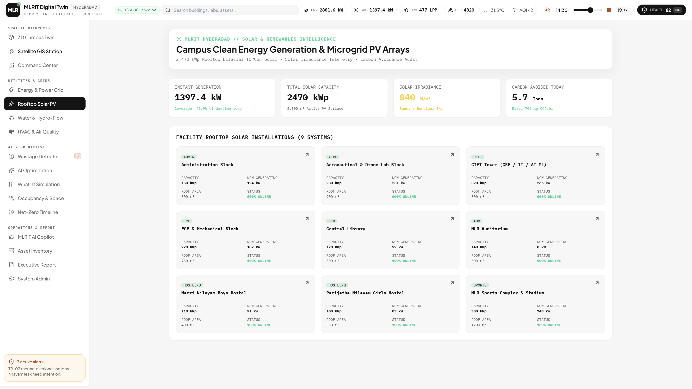 |

### Copilot, wastage, and what-if
| AI Copilot | Wastage detector |
|:----------:|:----------------:|
| 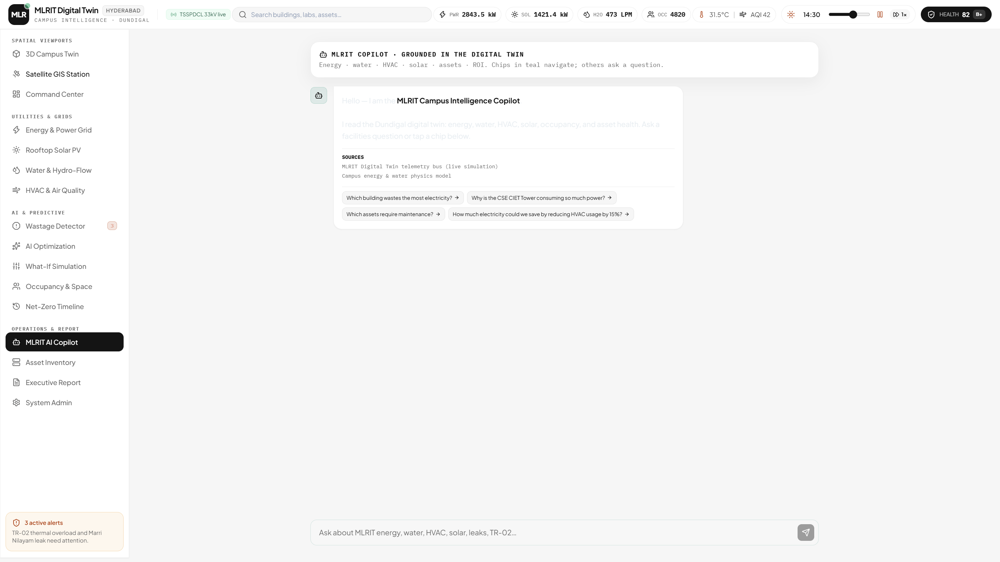 | 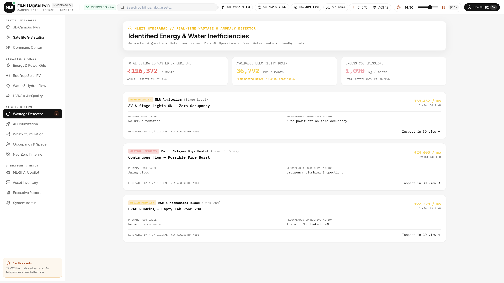 |
| 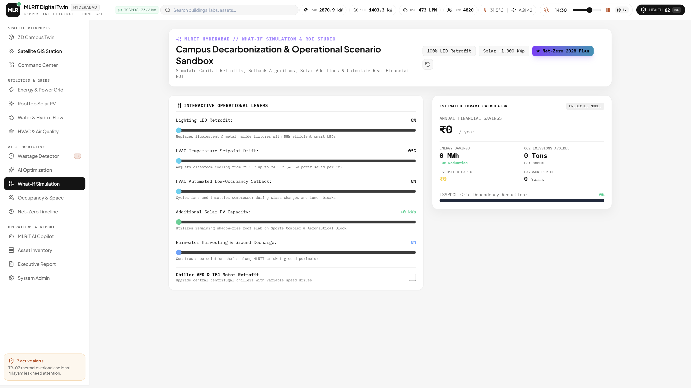 | 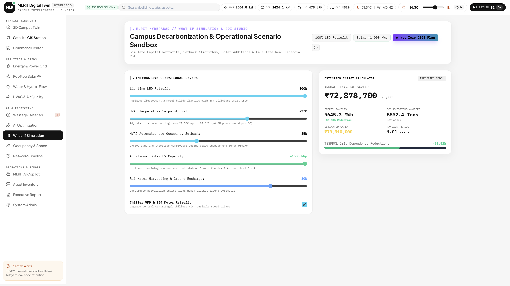 |

---

## 🚀 Live Access URLs
- **Interactive Command Center & 3D Digital Twin**: [http://127.0.0.1:5173](http://127.0.0.1:5173)
- **FastAPI Telemetry & Simulation Backend**: [http://127.0.0.1:8000](http://127.0.0.1:8000)
- **Interactive Swagger REST API Docs**: [http://127.0.0.1:8000/docs](http://127.0.0.1:8000/docs)
- **Live WebSocket Real-time Feed**: `ws://127.0.0.1:8000/ws/telemetry`

---

## 🏛️ Campus Profile: MLRIT Hyderabad
- **Institution**: Marri Laxman Reddy Institute of Technology (MLRIT)
- **Location**: Dundigal, Gandimaisamma Mandal, Medchal-Malkajgiri, Hyderabad, Telangana 500043
- **Geospatial Coordinates**: Latitude 17.5997° N, Longitude 78.4300° E
- **Campus Area**: 25.0 Acres (10.12 Hectares / 101,171 m²)
- **Facilities Modelled**:
  1. **MLRIT Administrative & Central Academic Block** (Principal, Deans, Examination Cell)
  2. **Aeronautical & Aerospace Engineering Block** (Subsonic Wind Tunnel, Flight Simulators, Avionics Cleanroom)
  3. **Computer Science & IT Innovation Tower (CIET)** (AI, ML, Robotics, Startups, 6 Floors)
  4. **ECE, EEE & Mechanical Engineering Complex**
  5. **Central Library & Digital Knowledge Hub**
  6. **Marri Laxman Reddy Auditorium & Convention Center** (2,000 Capacity)
  7. **MLRIT Boys Residential Block (Marri Nilayam)**
  8. **MLRIT Girls Residential Block (Parijatha Nilayam)**
  9. **MLR Sports Complex & Cricket Ground** (Indoor Stadium, 400m Track, Volleyball, Turf Pitch)
  10. **MLRIT 33kV Substation & Solar Farm** (TSSPDCL HT Line, Transformers TR-01 & TR-02, BESS Storage)

---

## 🌟 Key Capabilities Implemented

### 1. High-Fidelity 3D Campus Visualization (Three.js WebGL)
- Realistic architectural geometries with glass curtain ribbons, structural parapets, antennas, rooftop HVAC chillers, and ballasted solar PV modules.
- Campus landscape: Central quad turf, 400m athletics running track, cricket/soccer green pitch, asphalt ring road network with yellow centerlines, parking lots with 3D cars, and 280+ instanced trees.
- Substation yard with step-down transformers, high-voltage ceramic bushings, and BESS battery containers.
- Dynamic Diurnal Sun & Sky lighting linked to the simulation clock with day/night transitions.

### 2. Multi-Mode Spatial Viewports
- **3D Realistic**: Photorealistic materials, reflections, and shadow mapping.
- **Satellite GIS**: Top-down geospatial orthophoto texture with WGS-84 coordinate ticks.
- **Hybrid Mode**: 3D extruded campus structures overlaid directly on satellite base.
- **Heatmap Layer Modes**:
  - *Energy Intensity* (Green < 11 W/m², Amber 11-16 W/m², Red > 16 W/m²)
  - *Water Flow* (Cyan to Deep Blue & Alert Red)
  - *Occupancy Density* (Blue low, Amber medium, Rose high)
  - *Health & Maintenance Status*

### 3. "Enter Building" / Exploded Floor Dissection
- Click any building and hit **ENTER BUILDING // EXPLODE FLOORS**.
- Smoothly dissects the building into floating floor slabs.
- Select individual floors (Ground, Level 1, Level 2...) to inspect internal rooms, classrooms, laboratories, sensor temperatures, lighting states, and occupant headcounts.

### 4. Interactive 3D Spatial Measurement Tools
- **Laser Distance Measurement**: Click two points in the 3D world to measure distance in meters and feet.
- **Polygon Area Measurement**: Click 3 or more points on the campus to calculate enclosed surface area in $m^2$, $sq\ ft$, hectares, and acres using the Shoelace formula.

### 5. Energy Intelligence & Sankey Topology
- 4-Stage visual energy pipeline: TSSPDCL Grid 33kV → Dundigal 11kV Substation Transformers → Facility Loads → End-use apportionment (HVAC 50%, Lighting 28%, Computing/Wind Tunnel 22%).
- Real-time power factor, grid voltage, grid frequency, and peak demand tracking.

### 6. Water Intelligence & Real-Time Leak Detection
- Overhead break tank (150 kL) and underground sump (300 kL) live level gauges.
- Continuous leak detector flagging abnormal 138 LPM overnight flow in Marri Nilayam Boys Hostel with estimated financial loss (₹48,500/mo).

### 7. Rooftop Solar PV & Clean Energy
- 2,470 kWp installed across CIET, Aero, Sports, Hostels, and Substation roofs.
- Instant generation, irradiance ($W/m^2$), and carbon avoided today.

### 8. What-If Simulation Studio
- Interactive sliders: LED retrofit %, HVAC temperature setback °C, Low-occupancy runtime reduction %, Solar PV expansion +kWp, Rainwater harvesting %, and Chiller VFD upgrades.
- Instant recalculation of annual savings (₹), energy reduction (MWh), CO2 avoided (Tons), CapEx, and payback period.

### 9. Campus AI Copilot (Natural Language Assistant)
- Grounded in live MLRIT digital twin state. Answers questions regarding energy wastage, high-draw buildings, maintenance requirements, and optimization recommendations with evidence citations.

### 10. Executive Audit Reporting & Data Management
- Printable audit report with ISO 50001 / IGBC compliance matrices.
- 1-click CSV campus inventory export and full digital twin JSON snapshot backup.

---

## 🛠️ Tech Stack
- **Frontend**: React 19, TypeScript, Vite, Tailwind CSS v4, Lucide Icons, Three.js
- **Backend**: Python 3.13, FastAPI, Uvicorn, Pydantic, WebSockets
- **Architecture**: RESTful APIs + WebSocket real-time telemetry streaming
